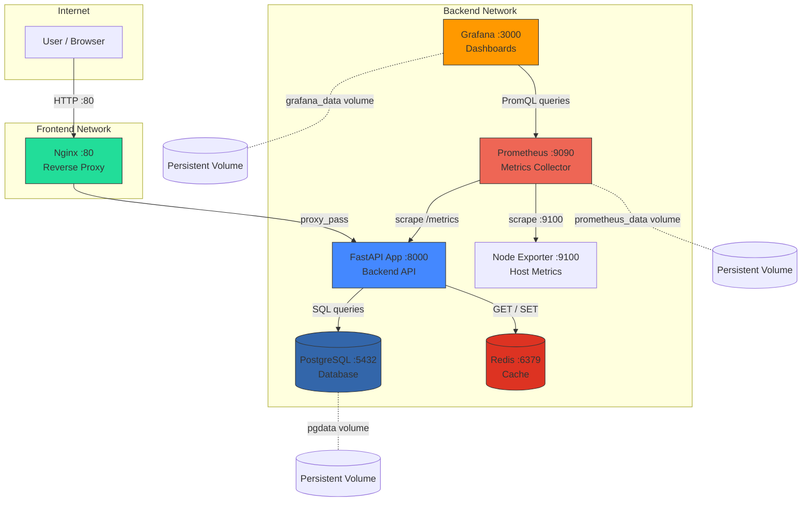

# Multi-Service Observability Stack

A production-style application stack running entirely in Docker. Seven containers work together: a user request enters through Nginx, gets handled by a Python API, data is stored in PostgreSQL and cached in Redis, and everything is monitored with Prometheus and visualized in Grafana.

---

## Architecture

How the pieces connect:



**What happens when you visit the app:**
1. Your browser hits `http://localhost` — Nginx receives the request on port 80
2. Nginx forwards it to the FastAPI app running on port 8000 (you never talk to the app directly)
3. The app writes a row to PostgreSQL and increments a counter in Redis
4. The app returns a JSON response with both counts
5. Meanwhile, Prometheus is scraping `/metrics` from the app every 15 seconds — silently collecting data in the background

---

## Services

| Service | Port | What it does |
|---|---|---|
| **Nginx** | `80` | Entry point. All traffic goes through here. Blocks `/metrics` from outside. |
| **FastAPI App** | internal | Python backend. Handles requests, talks to Postgres and Redis. |
| **PostgreSQL** | internal | Stores visit history. Data persists across restarts (volume). |
| **Redis** | internal | In-memory visit counter. Fast but resets on restart (no volume). |
| **Prometheus** | `9090` | Pulls metrics from the app and host every 15s. Stores them as time-series data. |
| **Grafana** | `3000` | Reads from Prometheus and draws graphs. |
| **Node Exporter** | internal | Exposes host-level metrics (CPU, RAM, disk) to Prometheus. |

---

## Project Structure

```
multi-service-observability-stack/
├── docker-compose.yml          # Defines all 7 services, networks, and volumes
├── Makefile                    # Shortcut commands (make up, make backup, etc.)
├── .env                        # Secrets and config (not committed to git)
├── .gitignore
│
├── app/
│   ├── main.py                 # FastAPI application — routes, DB logic, metrics
│   ├── requirements.txt        # Python dependencies
│   └── Dockerfile              # How to build the app container
│
├── nginx/
│   └── nginx.conf              # Reverse proxy config, blocks /metrics externally
│
├── prometheus/
│   └── prometheus.yml          # Which services Prometheus scrapes and how often
│
├── grafana/
│   └── provisioning/
│       ├── datasources/
│       │   └── datasource.yml  # Auto-connects Grafana to Prometheus on startup
│       └── dashboards/
│           └── app-dashboard.json  # Pre-built dashboard, loaded automatically
│
└── scripts/
    └── backup.sh               # Dumps PostgreSQL, optionally uploads to S3
```

---

## Quick Start

**Requirements:** Docker and Docker Compose v2 installed.

```bash
# 1. Clone the repo
git clone <repo-url>
cd multi-service-observability-stack

# 2. Start everything
make up

# 3. Check it's working
make test
```

That's it. All 7 containers start, the database initializes itself, and the app is ready.

---

## What You Can Access

| URL | What you see |
|---|---|
| `http://localhost/` | JSON response with visit counters from Redis and PostgreSQL |
| `http://localhost/health` | `{"status": "healthy"}` — used to check the app is alive |
| `http://localhost/metrics` | **403 Forbidden** — blocked by Nginx on purpose |
| `http://localhost:9090` | Prometheus UI — explore raw metrics, check scrape targets |
| `http://localhost:3000` | Grafana — login with `admin / admin` |

---

## Make Commands

```bash
make up         # Start all containers in the background
make down       # Stop all containers (data is preserved)
make restart    # Restart all containers
make build      # Rebuild images from scratch (use after code changes)

make logs       # Stream logs from all containers
make logs-app   # Stream logs from the app only

make status     # Show running containers, volumes, and networks
make test       # Hit / and /health, print the JSON responses

make backup     # Dump the PostgreSQL database to /tmp/backups/
make restore FILE=path/to/backup.sql.gz  # Restore from a dump file

make clean      # Stop everything AND delete all volumes and images (destructive)
```

---

## How Monitoring Works

**Prometheus (pull model):**
- Every 15 seconds, Prometheus sends an HTTP GET to `http://app:8000/metrics`
- The app responds with all its counters and histograms in a plain-text format
- Prometheus stores the values as time-series data with timestamps
- You can query this data at `http://localhost:9090` using PromQL

**Useful PromQL queries to try in Prometheus:**
```
app_requests_total                                          # raw request counter
rate(app_requests_total[5m])                               # requests per second (5m window)
histogram_quantile(0.95, rate(app_request_latency_seconds_bucket[5m]))  # p95 latency
node_cpu_seconds_total                                      # raw CPU time by mode
100 - (avg(rate(node_cpu_seconds_total{mode="idle"}[5m])) * 100)        # CPU usage %
```

**Grafana:**
- Opens at `http://localhost:3000` (login: `admin` / `admin`)
- Prometheus is pre-configured as a datasource — no manual setup needed
- A dashboard is pre-loaded automatically via provisioning

---

## Network Isolation

Containers are split into two Docker networks:

```
frontend network:  nginx ←→ app
backend network:   app ←→ postgres, redis, prometheus, grafana, node-exporter
```

- **Nginx** only sees **app** — it cannot reach the database directly
- **Postgres** and **Redis** are invisible to Nginx — they only exist on the backend network
- This mirrors how real production systems are segmented

To verify isolation:
```bash
# This should FAIL (nginx has no route to postgres):
docker compose exec nginx ping -c 2 postgres

# This should SUCCEED (app is on both networks):
docker compose exec app ping -c 2 postgres
```

---

## Data Persistence

| What | Persists after restart? | Why |
|---|---|---|
| PostgreSQL visits | Yes | Stored in `pgdata` Docker volume |
| Prometheus metrics | Yes | Stored in `prometheus_data` Docker volume |
| Grafana dashboards | Yes | Stored in `grafana_data` Docker volume |
| Redis visit counter | **No** | No volume — Redis is used as a cache here |

To verify:
```bash
make down
make up
# Visit http://localhost/ — the db_count picks up where it left off
# But visits_redis resets to 1
```

---

## Backup & Restore

```bash
# Create a compressed dump of the PostgreSQL database
make backup
# Saves to /tmp/backups/appdb_backup_TIMESTAMP.sql.gz

# Restore from a backup file
make restore FILE=/tmp/backups/appdb_backup_20240101_030000.sql.gz
```

The backup script also supports uploading to AWS S3:
```bash
export S3_BUCKET=your-bucket-name
./scripts/backup.sh
```

If `aws` CLI is not installed, it skips the S3 upload and saves locally.

To automate backups, add this to crontab (`crontab -e`):
```
0 3 * * * cd /path/to/project && ./scripts/backup.sh >> /var/log/backup.log 2>&1
```

---

## Environment Variables

All secrets live in `.env` (never committed to git):

```env
DB_NAME=appdb
DB_USER=appuser
DB_PASSWORD=apppass
REDIS_PORT=6379
```

The app reads these via `os.getenv()`. Docker Compose injects them into containers via `env_file: .env`.
